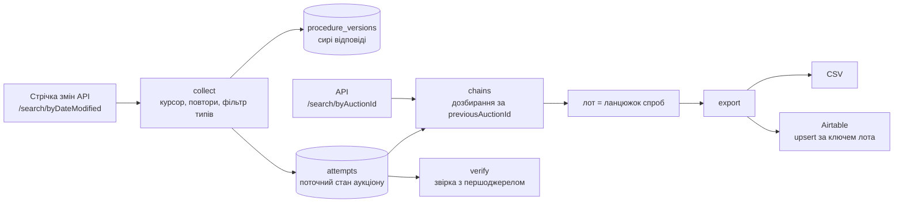
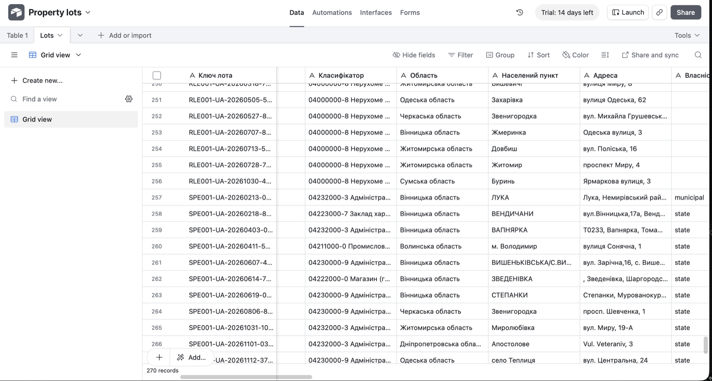

# Історія лотів Prozorro.Продажі

Збирач на Python, який із публічного API [Prozorro.Продажі](https://prozorro.sale) будує повну історію
торгів по об'єктах нерухомості та землі: кожен аукціон лота, зокрема ті, що не відбулися або були
скасовані, і всі повторні торги. Кожен запис має посилання на першоджерело, дублікатів немає, а
результат вивантажується в Airtable для перевірки людиною.

- **Інкрементальний збір** зі стрічки змін: курсор зберігається після кожної сторінки, перерваний
  запуск продовжує з місця зупинки.
- **Без дублікатів на кожному рівні**: сторінки стрічки, повторні запуски, версії процедури, лоти,
  записи в Airtable.
- **Історія лота**: ланцюжок повторних торгів зводиться в один лот з усіма спробами.
- **Першоджерела**: посилання на API і на сторінку лота в кожному записі, команда `verify` звіряє
  збережене з джерелом.
- **Airtable**: upsert за ключем лота; колонки рецензента синхронізація ніколи не перезаписує.
- 64 тести на записаних відповідях справжнього API, CI, приклад запуску за розкладом на Linux.

Результат живого запуску можна подивитися без встановлення:
[таблиця лотів в Airtable](https://airtable.com/appqGLFLpOiKJSOAg/shrcClYqzJwd4XpCU) (лише перегляд, 270 лотів).

## Швидкий старт

Потрібен Python 3.11+.

```bash
python -m venv .venv && source .venv/bin/activate
pip install -e ".[dev]"
cp .env.example .env            # необов'язково: доступ до Airtable

lot-history collect --since 2026-11-15T00:00:00   # перший запуск: звідки читати стрічку
lot-history chains                                # дозібрати попередні торги, звести в лоти
lot-history export --csv data/lots.csv            # один рядок на лот
lot-history export --airtable --dry-run           # що піде в Airtable, без запису
lot-history verify SPE001-UA-20261115-55411       # звірити аукціон із джерелом
lot-history stats
```

Наступні запуски `lot-history collect` без `--since` читають лише нове: від збереженого курсора.

## Як це працює



1. **collect** читає стрічку `GET /api/search/byDateModified/{момент}?limit=N`: процедури, відсортовані
   за часом зміни. З кожної процедури лишаються тільки поля, потрібні для перевірки (`Attempt`), сира
   відповідь зберігається окремо.
2. **chains**. Аукціон, який не відбувся, публікують знову як новий, і його `previousAuctionId`
   вказує на попередній. Стрічка за останні дні віддає лише свіжі аукціони, тому попередні
   дозбираються за номером (`/api/search/byAuctionId/{номер}`), доки ланцюжок не дійде до першого.
3. **export** зводить ланцюжок в один рядок: скільки було спроб, скільки не відбулося, з якої ціни
   почали і яка зараз, історія з посиланням на сторінку кожного аукціону.

## Як уникаємо дублікатів

| Рівень | Звідки береться дублікат | Що робимо |
|---|---|---|
| Сторінки стрічки | Межа `byDateModified` включна: наступна сторінка починається з останнього запису попередньої | Версія зберігається за ключем `(procedure_id, dateModified)`; повторну просто пропускаємо |
| Повторний запуск | Той самий період читається ще раз | Той самий ключ: другий запуск нічого не додає (перевірено тестом) |
| «Порожні» зміни | Процедуру оновили (новий документ, запитання), але для перевірки нічого не змінилося | Хеш SHA-256 по відстежуваних полях: версія зберігається, але зміною не вважається |
| Лоти | Той самий об'єкт виставляють 5–10 разів під різними номерами | Усі спроби ланцюжка `previousAuctionId` отримують один ключ лота |
| Airtable | Кожна синхронізація надсилає ті самі лоти | `performUpsert` за колонкою «Ключ лота»: запис оновлюється, а не дублюється |

Старіша версія ніколи не перезаписує новішу: якщо дозбирання принесло стан, давніший за вже
збережений, він лишається тільки в `procedure_versions`.

Якщо ціла сторінка стрічки має одну й ту саму позначку зміни, наступний запит повернув би ту саму
сторінку. У такому разі збирач розширює сторінку, доки не дійде до пізнішої позначки, і нічого не
пропускає.

## Перевірка за першоджерелом

Кожен аукціон зберігає два посилання: на API (`source_api_url`) і на публічну сторінку
(`source_page_url`). Команда `verify` завантажує аукціон заново і показує кожне поле, де сховище і
джерело розійшлися:

```text
$ lot-history verify SPE001-UA-20261115-55411
сторінка лота: https://prozorro.sale/auction/SPE001-UA-20261115-55411/
у сховищі станом на 2026-11-15T07:24:11.554000+00:00, у джерелі 2026-11-15T07:24:11.554000+00:00
збігається з джерелом
```

Код повернення 0 означає збіг, 1 — розбіжність або аукціон зник із джерела, 2 — аукціону немає у
сховищі. Сира відповідь API кожної версії лежить у `procedure_versions.raw_json`, тож будь-яке
нормалізоване значення можна простежити до того, що віддало джерело.

## Airtable

1. Створіть базу та [персональний токен](https://airtable.com/create/tokens) з правами
   `data.records:read`, `data.records:write`, `schema.bases:read`, `schema.bases:write` і доступом до
   цієї бази.
2. Запишіть `AIRTABLE_TOKEN` і `AIRTABLE_BASE_ID` у `.env`.
3. `lot-history export --airtable` створить таблицю (якщо її ще немає) і запише лоти.

Колонки «Перевірка» (На перевірку / Перевірено / Відхилено) і «Нотатки» призначені для рецензента.
Вони створюються разом із таблицею, і синхронізація їх більше не чіпає: рішення людини переживає
будь-яку кількість повторних запусків.

Запити йдуть пакетами по 10 записів із паузою між ними; на HTTP 429 клієнт чекає 30 секунд і
повторює пакет.

Таблиця після живої синхронізації, лише перегляд: <https://airtable.com/appqGLFLpOiKJSOAg/shrcClYqzJwd4XpCU>



## Приклад із реального запуску

Запуск 16 листопада 2026 року на живому API, три сторінки стрічки від 15.11.2026:

```text
$ lot-history collect --since 2026-11-15T00:00:00 --max-pages 3
сторінок 3, записів 300: нових аукціонів 274, змінених 0, без змін 0, уже збережених 2, інших типів пропущено 24

$ lot-history chains
дозібрано попередніх аукціонів 901, не знайдено в джерелі 0, лотів 270

$ lot-history stats
версій процедур: 1175
аукціонів (спроб): 1175
лотів: 270
не відбулося: 1113
скасовано: 14
повторних торгів: 905
попередніх аукціонів не знайдено в джерелі: 0

$ lot-history export --airtable
створено таблицю 'Lots'
Airtable: створено 270, оновлено 0

$ lot-history export --airtable        # другий запуск
Airtable: створено 0, оновлено 270
```

274 свіжі аукціони зі стрічки розгорнулися в 1175 аукціонів і 270 лотів: 149 лотів виставляли
більше одного разу, 53 — п'ять і більше разів, 31 — десять і більше. Найдовша історія в цій вибірці:
оренда земельної ділянки в Олександрії, 35 торгів із січня 2022 року, жодні не відбулися. (`chains`
запускався двома частинами через ліміт запитів на запуск; 901 — сума.)

Один лот повністю: виробничі будівлі у Володимирі (Волинська область), державна власність, мала
приватизація. Сім місяців, 16 аукціонів, п'ять однакових кіл: англійський аукціон за повною ціною,
повторний за половину, голландський, який скасовують.

```text
 1. 2026-04-11 SPE001-UA-20260411-55265 unsuccessful     | 6,325,762.00 UAH
 2. 2026-05-05 SPE001-UA-20260505-95218 unsuccessful     | 3,162,881.00 UAH
 3. 2026-05-13 SPD001-UA-20260513-25124 cancelled        | 3,162,881.00 UAH
 4. 2026-05-22 SPE001-UA-20260522-28555 unsuccessful     | 6,325,762.00 UAH
 ...
14. 2026-10-28 SPE001-UA-20261028-36881 unsuccessful     | 3,162,881.00 UAH
15. 2026-11-05 SPD001-UA-20261105-72962 cancelled        | 3,162,881.00 UAH
16. 2026-11-15 SPE001-UA-20261115-55411 active_tendering | 6,325,762.00 UAH
```

У таблиці для перевірки це один рядок: 16 спроб, 10 не відбулося, 5 скасовано, поточний статус
`active_tendering`, і посилання на сторінку кожного з 16 аукціонів у колонці «Історія».

## Запуск за розкладом на Linux

У `deploy/` лежать `lot-history.service` і `lot-history.timer` для systemd: щогодини `collect`,
`chains`, `export --airtable`. Токени читаються з `/etc/lot-history.env` (доступ лише для root), база
лежить у `/var/lib/lot-history/`.

```bash
sudo cp deploy/lot-history.* /etc/systemd/system/
sudo systemctl enable --now lot-history.timer
journalctl -u lot-history.service -n 20      # вивід останнього запуску
```

## Модель даних

SQLite, один файл.

| Таблиця | Що зберігає |
|---|---|
| `procedure_versions` | Сира відповідь API на кожну пару `(procedure_id, dateModified)` |
| `attempts` | Поточний стан кожного аукціону: статус, ціна, об'єкт, адреса, посилання, ключ лота |
| `status_history` | Коли аукціон перейшов у кожен зі статусів |
| `unresolved_previous` | Попередні аукціони, яких джерело не знає, щоб не питати про них знову |
| `cursors` | Позначка, з якої продовжувати читання стрічки |

## Тести

```bash
pytest -q          # 64 тести, без мережі
ruff check . && ruff format --check .
```

Тести працюють на відповідях справжнього API, записаних скриптом `scripts/record_fixtures.py`:
сторінка стрічки і ланцюжок із 12 аукціонів однієї будівлі. Скрипт лишає тільки поля, які читає
збирач; контактних осіб, рахунків, ставок і документів у фікстурах немає.

## Рішення та обмеження

- **Тільки нерухомість і земля.** Тип визначається за класифікатором CAV першого об'єкта лота
  (`04…` — нерухомість, `06…` — земля). `collect --all-kinds` зберігає все.
- **Номер спроби джерела не є загальним лічильником.** `tenderAttempts` рахує спроби в межах одного
  кола продажу (1, 2, 3, потім знову 1), тому кількість торгів береться з довжини ланцюжка.
- **Ключ лота стабільний лише після повного дозбирання.** Доки `chains` не дійшов до першого
  аукціону, ключем є найраніший відомий номер. `export` попереджає, якщо ланцюжки ще неповні.
- **Навмисно повільно.** API не публікує ліміту запитів, тому між запитами пауза 0,5 с, а на 429 і
  5xx — повтори з подвоєнням паузи.
- **Персональні дані.** У нормалізованому вигляді зберігається назва продавця, лише якщо це
  юридична особа з ЄДР. Сирі відповіді з контактами лежать тільки в локальній базі, яка не
  потрапляє в git.
- **Поза межами прикладу:** інші джерела, геокодування адрес, моніторинг запусків.

## Структура

```text
src/lot_history/
  client.py       клієнт API: повтори, паузи
  normalize.py    сира процедура -> Attempt, хеш вмісту
  store.py        SQLite: версії, спроби, історія статусів, курсор
  collector.py    читання стрічки
  chains.py       дозбирання попередніх торгів, ключі лотів
  export.py       рядок на лот, CSV
  airtable.py     upsert у таблицю перевірки
  verify.py       звірка з першоджерелом
  cli.py          команди
tests/            64 тести на записаних відповідях API
scripts/          запис фікстур із живого API
docs/             знімок таблиці Airtable
deploy/           systemd service + timer
```

## Ліцензія

MIT.
